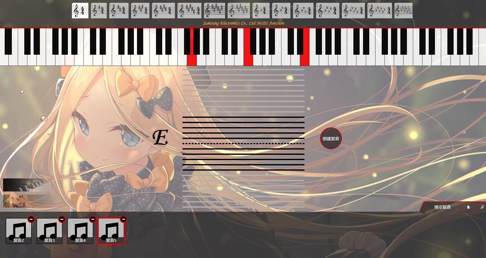

# MIDI Piano 
支持MIDI键盘, 虚拟MIDI键盘输入的辅助在线识谱工具

## 部署要求

纯静态项目，使用 Nginx 或静态站点托管即可，无后端依赖；已提供 Dockerfile。部署时保留资源目录结构，推荐使用 Chrome，MIDI 功能要求 HTTPS 或 localhost 安全上下文。

音频通过 `fetch()` 预加载并解码到内存，以降低弹奏延迟。`file://` 下的请求会受浏览器限制，因此需通过 HTTP/HTTPS 访问，不能直接双击 HTML。音频默认关闭，需手动开启并等待采样加载完成。

主要功能:
1. 88键钢琴音频, 点击键盘即可播放对应音频, 同时可通过MIDI键盘演奏(次要)
2. 全键位五线谱展示, 鼠标悬停至对应线/间, 即可显示对应的琴键以及音名
3. 调号修改功能, 修改调号后, 悬停对应五线谱时, 对应琴键会将根据当前调号变更
4. 复音记录功能
	+ 左键单击五线谱任意线/间, 将点亮当前琴键, 支持多个音同时点亮
	+ 点击右侧"创建复音"按钮可创建一个复音, 显示在下方, 或鼠标右键取消选中
	+ 在下方复音列表中点击创建的复音, 可以点亮复音包含的键, 按下键盘左/右方向键可左右切换
5. 主题切换, 目前提供原皮和一个ACG皮肤, 通过左边图片按钮点击切换
6. MIDI设备接入, 当有可使用的MIDI设备时, 键盘上方金色文字会显示当前连接的MIDI设备名称
7. 训练模式, 通过点亮五线谱帮助记忆对应的琴键
    + 点击右边中间的马头按钮, 即可开启训练模式, 再次点击关闭. 当调号变更后, 模式也会重新开启, 
    + 训练模式将随机点亮范围内五线谱, 通过点击正确的钢琴键, 即可消除并开始下一个音
    + 支持通过MIDI键盘进行训练
8. 简单的乐谱播放, 目前包含卡农和共病文库的一小部分, 仅供娱乐, 最右边音符按钮点击即可播放

**注: 因主要自己用, 仅Chrome能获取良好体验, 其他浏览器没有适配计划**

预览地址: https://acgnu.github.io/AxRythem/

预览:

	
